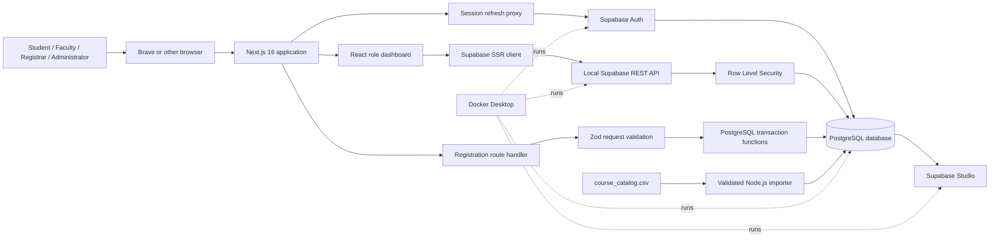
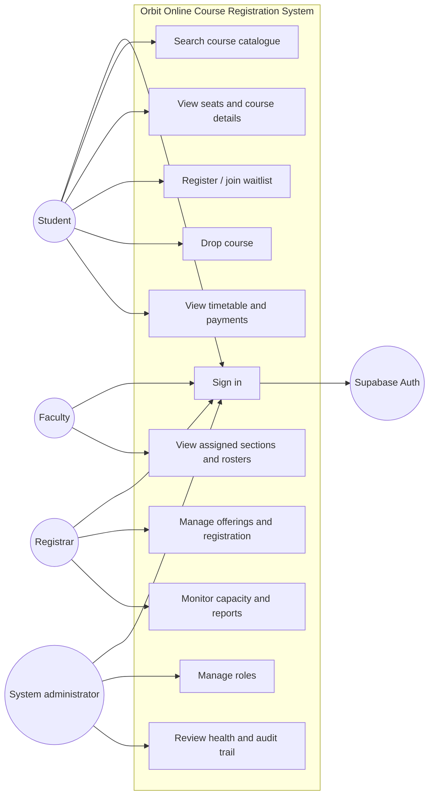
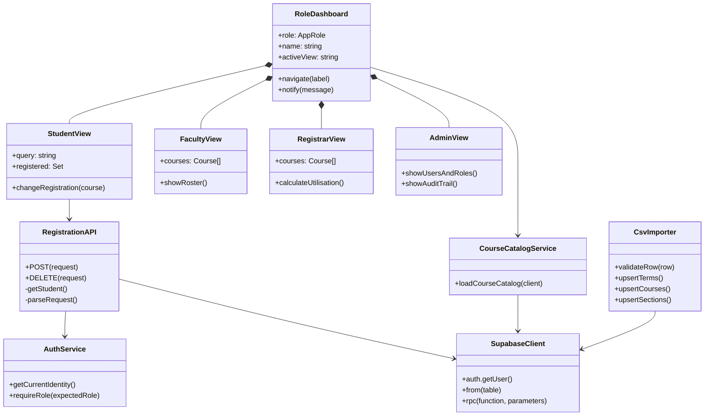
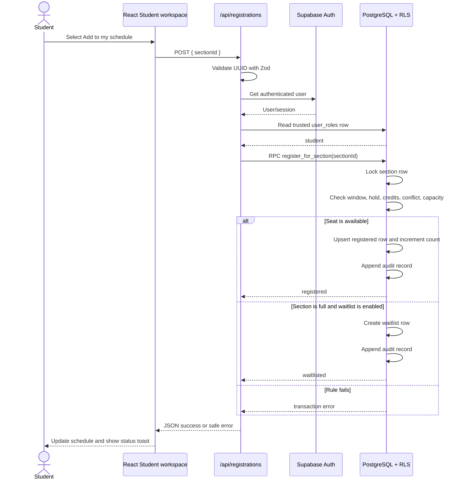
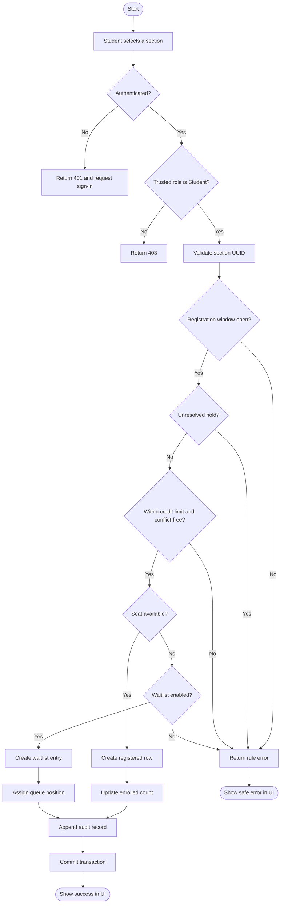
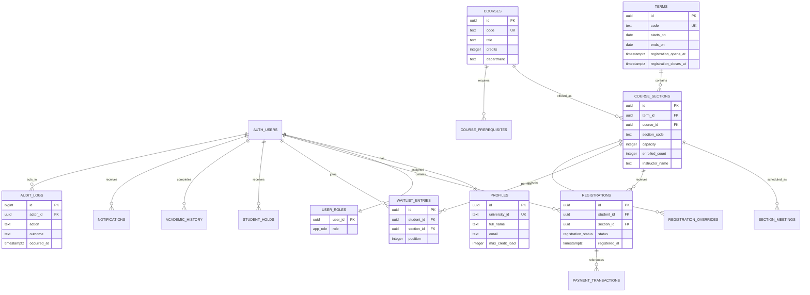
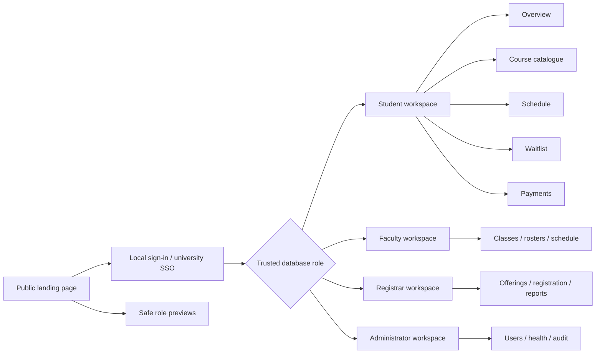

# System design diagrams

These Mermaid definitions are the editable source for Section 5 of the report. They
describe the implemented architecture rather than an unrelated ideal system. They
will be rendered to high-resolution figures when the final Word report is created.

## 5.1 System architecture

## 5.2 Use case diagram

## 5.3 Application class diagram

## 5.4 Registration sequence diagram

## 5.4 Registration activity diagram

## 5.5 ER diagram / database design

## 5.6 UI design scheme

The visual system uses a calm teal/mint base with blue, gold, and rose status accents,
rounded cards, visible focus indicators, responsive navigation, and text labels in
addition to colour. The full implementation is in `src/app/globals.css`.

